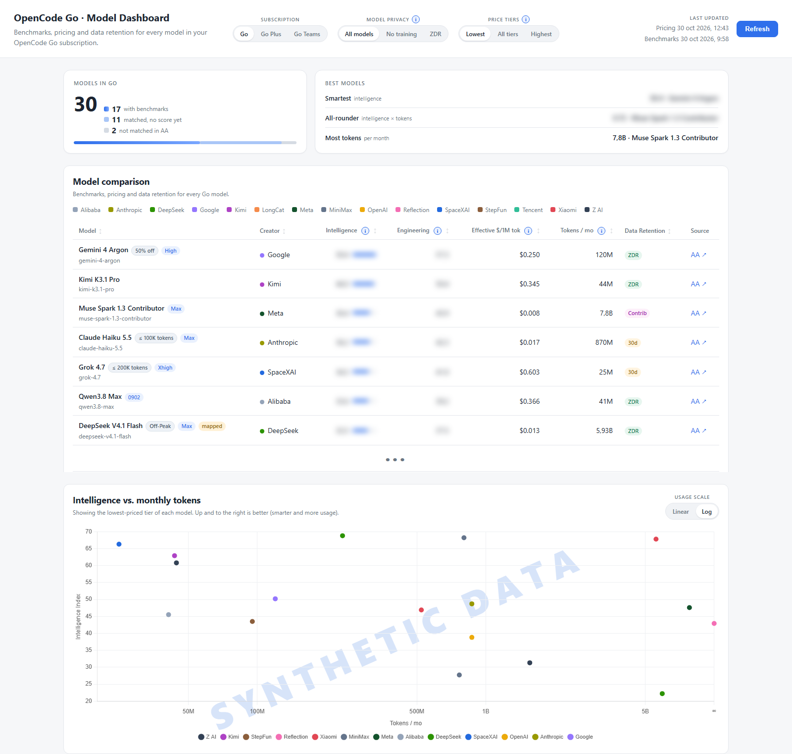

# OpenCode Go · Model Dashboard

A small, dependency-free dashboard that shows how the chat models in your **OpenCode Go** subscription actually compare: how smart they are according to [Artificial Analysis](https://artificialanalysis.ai/), what they cost under real agent traffic, how many tokens each plan buys, and what each provider retains.

> **Unofficial project.** Not affiliated with, endorsed by, or supported by Anomaly Innovations, Inc. or Artificial Analysis. "OpenCode" and "OpenCode Go" are trademarks of Anomaly Innovations, Inc.

[](docs/screenshot.png)

> **Illustrative screenshot.** Artificial Analysis benchmark values in the table are blurred, and the chart plots synthetic intelligence scores, not real results. AA's free API is for internal use only, so no AA benchmark values are reproduced in this image. See [Data sources, attribution & licensing](#data-sources-attribution--licensing).

## What you get

- **Comparison table** — intelligence, engineering, effective price per 1M tokens, tokens per month, data retention and training flags for every Go chat model, sortable on any column.
- **Intelligence vs. tokens chart** — what a plan's monthly allowance buys you in practice, with a "most attractive" quadrant, a Pareto line through the models nothing beats on price and score, and a log/linear axis switch.
- **Plan switch** — Go, Go Plus and Go Teams side by side. Token prices are the same across plans; only the monthly allowance changes.
- **Filters** — hide models whose prompts may be used for training, keep only zero-retention models, or collapse price tiers to their cheapest or most expensive rate.
- **Best-model cards** — smartest, best all-rounder (intelligence × tokens) and most tokens per month, for whatever is currently on screen.
- **JSON API** — the page is rendered from `GET /api/dashboard`, so the same numbers can be scripted against.

Only chat models are listed. Artificial Analysis' language benchmarks do not cover Go's decision or embedding endpoints, so those are excluded.

## Quick start

You need **Node.js 20+** (built on Node 24). There is nothing to install: the server uses Node's built-in `http` module and global `fetch`, and the chart library comes from a CDN.

1. Get a free API key from the [Artificial Analysis Insights Platform](https://artificialanalysis.ai/login). Benchmarks need it — without a key the dashboard still runs and shows pricing and retention.
2. Copy `.env.example` to `.env` and add the key:

   ```
   AA_API_KEY=your_key_here
   ```

3. Start the server and open <http://localhost:8787>:

   ```bash
   node server.mjs
   ```

`npm start` does the same thing, and `npm run dev` restarts on file changes.

## Using it

The page loads once and then stays put until you press **Refresh** — that button is the only thing that fetches new data, and the two "Last updated" timestamps tell you which copy you are looking at. Switching the plan re-prices the table and chart; the privacy and price-tier filters apply to everything on the page.

Models without an Artificial Analysis entry land in a "No benchmark data found" panel and can be pinned by hand in [`overrides.json`](overrides.json).

Badges, chart behaviour and tier details: [docs/ui.md](docs/ui.md).

## How the numbers work

**Effective $/1M tok** blends the three published token prices using a traffic mix measured across the current Go lineup:

```
0.045 × input + 0.9485 × cached read + 0.0065 × output
```

**Tokens / mo** is the plan's monthly allowance divided by that effective price — the number of effective tokens the plan buys. The same mix is applied to every model, so the comparison stays fair.

It is deliberately not Artificial Analysis' 7/2/1 split: coding-agent traffic is far more cache-heavy. Context-size and peak/off-peak rates are kept as separate price tiers.

Derivation, caveats and exact figures: [docs/pricing.md](docs/pricing.md).

## Configuration

Secrets and the port live in `.env` (gitignored). Non-secret settings live in `settings.json` (committed, contains no secrets).

### `.env`

| Variable     | Default | Purpose                                              |
| ------------ | ------- | ---------------------------------------------------- |
| `AA_API_KEY` | –       | Artificial Analysis API key (needed for benchmarks). |
| `PORT`       | `8787`  | HTTP port.                                           |

### `settings.json`

| Key             | Default                                     | Purpose                                     |
| --------------- | ------------------------------------------- | ------------------------------------------- |
| `GO_MODELS_URL` | `https://opencode.ai/inference/go/v1/models` | Live Go models, prices and plan allowances. |
| `GO_DOCS_URL`   | raw `go.mdx` on the `dev` branch             | Retention table and notes.                  |
| `AA_BASE_URL`   | `https://artificialanalysis.ai/api/v2`       | Artificial Analysis API base.               |

Missing keys fall back to the defaults above; an unreadable `settings.json` logs a warning and uses all of them.

Both datasets are cached in `cache/` and re-fetched only on **Refresh** or when no usable cache exists. The Artificial Analysis free tier allows 100 requests per fixed 24-hour window and the full catalogue takes about four, so a handful of refreshes a day is plenty. Cache versions and the matching rules: [docs/data-and-matching.md](docs/data-and-matching.md).

## Data sources, attribution & licensing

This is an unofficial project and is not affiliated with Anomaly Innovations, Inc. ("OpenCode") or Artificial Analysis.

- **Model list, token prices, plan allowances and training/ZDR flags** are read from the live OpenCode Go models endpoint (`https://opencode.ai/inference/go/v1/models`). The dashboard reads it locally, once per explicit Refresh; the response is cached locally in `cache/go.json` and is not committed or redistributed by this project.
- **Retention details** are parsed from the MIT-licensed [`go.mdx`](https://github.com/anomalyco/opencode/blob/dev/services/site/src/docs/content/console/go.mdx) source. The rendered page is <https://opencode.ai/v2/docs/console/go/>.
- **Benchmarks** are provided by [Artificial Analysis](https://artificialanalysis.ai/) and displayed under their free API terms, which require attribution and permit **internal use only — no redistribution**. You must supply your own `AA_API_KEY`. Benchmark data is cached locally in `cache/aa.json` and is not committed to this repository. If you deploy this dashboard publicly, or redistribute the data in any form, you need a license from Artificial Analysis that grants those rights.
- **Code** in this repository is MIT licensed; see [LICENSE](LICENSE). The licences of the data above are separate and do not extend to it. The live Go models endpoint is a hosted OpenCode service and is used here only for local model discovery; it is not covered by the repository's MIT licence.

## Documentation

| Document | Covers |
| --- | --- |
| [docs/ui.md](docs/ui.md) | Columns, badges, filters, price tiers, chart and refresh behaviour. |
| [docs/pricing.md](docs/pricing.md) | Effective price, the traffic mix and its derivation, promotions, tiers. |
| [docs/data-and-matching.md](docs/data-and-matching.md) | Sources, cache policy, chat-only rule, name matching, HTTP endpoints. |
